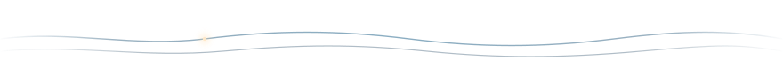

  <b>EN</b> &nbsp;·&nbsp; <a href="README.ru.md">RU</a>

  

  ANONYMOUS BY DESIGN · NO NAME · NO FACE

### A stranger, with the light on.
This is not a portfolio, not a CV, not a brand. It is a working light, and the few things it happens to illuminate.

  

**now**

- Teaching a document index to live entirely on disk — no cloud, no keys, no upload.
- Pulling computer vision out of the cloud: frames in, boxes out, offline.
- Writing specs as failing tests, then making them pass.

**how i work**

- **Small surface.** One tool, one job. If it needs a dashboard, it is probably two tools.
- **Local first.** If it cannot think without the internet, it is not finished.
- **Cold read.** Code, docs and copy should survive a stranger reading them at 2 a.m.

**stack**

  

**signal**

No email, no messengers, no calendar link. The inbox is this repository — open an issue or start a discussion, and it will be read.

Everything else stays quiet.

  

