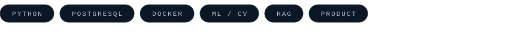
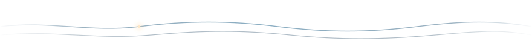

  <a href="README.md">EN</a> &nbsp;·&nbsp; <b>RU</b>

  

  АНОНИМНО ПО УМОЛЧАНИЮ · БЕЗ ИМЕНИ · БЕЗ ЛИЦА

### Незнакомец, у которого горит свет.

Я делаю небольшой тихий софт: тот, что живёт на вашей машине, хранит данные там же и не просит регистрацию.

Почти всё — на стыке продукта и кода: локальный поиск, компьютерное зрение, которое не уходит в облако, и спецификации, написанные настолько строго, что они уже тесты.

Это не портфолио, не резюме и не бренд. Это работающий маяк и то немногое, что он освещает.

**сейчас**

- Учу индекс документов жить целиком на диске — без облака, ключей и загрузок.
- Вытаскиваю компьютерное зрение из облака: кадры внутрь, рамки наружу, офлайн.
- Пишу спецификации падающими тестами и довожу их до зелёного.

**как я работаю**

- **Малая поверхность.** Один инструмент — одна задача. Если нужен дашборд, это, скорее всего, два инструмента.
- **Локально.** Если без интернета не думается — значит, ещё не готово.
- **Холодное чтение.** Код, документы и тексты должны выдерживать незнакомца в два часа ночи.

**стек**

  

**сигнал**

Ни почты, ни мессенджеров, ни ссылки на календарь. Входящие — этот репозиторий: issue или discussion, и это будет прочитано.

Всё остальное остаётся тихим.

  

